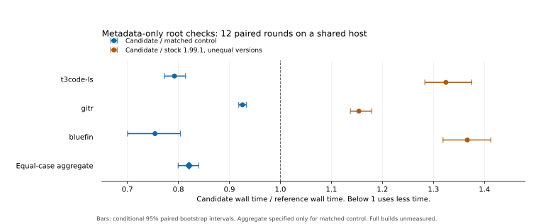

# CGU16 and ThinLTO root-check pilot

The optimized stage2 package used **17.9% less wall time** than the matched
no-PGO stage2 control across these three fixed root checks. Its paired geometric
candidate/control ratio was **0.820912**, with conditional 95% bootstrap interval
**[0.799523, 0.840145]**. It passed the preregistered numerical decision and
independent evidence review. The candidate still used more time than stock
Rust 1.99.1 on every workload. Stock differs in compiler, Cargo and LLVM versions.

This measures dependency-primed, metadata-only checks of selected package roots.
It does not measure full builds, application execution speed or cold disk caches.
The two compiler settings form one treatment, including bootstrap preparation
and native build effects. Their individual contributions are unidentified.



## Results

Ratios divide the named numerator's time by the denominator's time. Below 1
means the numerator used less time. Every interval is conditional on the stated
pairing and independence assumptions.

| Case | Candidate / matched control wall | Candidate / stock wall | Candidate / control CPU |
| --- | --- | --- | --- |
| t3code-ls | 0.792304 [0.772453, 0.814194] | 1.324420 [1.283068, 1.375184] | 0.762759 [0.741401, 0.785974] |
| gitr | 0.925701 [0.918359, 0.933664] | 1.153832 [1.137095, 1.178890] | 0.884592 [0.871946, 0.898046] |
| bluefin | 0.754270 [0.700388, 0.804305] | 1.366359 [1.318766, 1.412539] | 0.750893 [0.696767, 0.800980] |
| Equal-case aggregate | 0.820912 [0.799523, 0.840145] | Not specified | Not specified |

The CPU ratios are candidate/control and cover waited ancestry. The maximum
observed matched pair RSS ratio was **1.013375**, passing all 36 exact integer
checks against the 1.20 limit. This RSS is the largest waited process, not
simultaneous aggregate build memory. Aggregate RAM and energy remain unmeasured.

The aggregate gives each of these three cases equal weight. It is neither a
ratio of summed seconds nor an estimate for arbitrary Rust projects. The
preregistered decision required aggregate point at most 0.97, conditional upper
endpoint below 1, every case point at most 1.03, all scoped RSS checks and the
correctness/input/host gates. Passing this decision permits a bounded experiment;
it does not establish release acceptance or universal compiler correctness.

## Workloads and controls

| Repository | Revision | Selected check | Tests per lane, before and after |
| --- | --- | --- | --- |
| [t3code-ls](https://github.com/glopyglerky/t3code-ls) | `c90f1b601fc39e8d9eabc269408f8247b26a5bef` | `t3-code-ls-core --lib` | 56 passed |
| [gitr](https://github.com/glopyglerky/gitr) | `a183e205ec21e1b916e3763ba85917f2842aeae5` | `gitr --bin gitr` | 38 library tests passed, five ignored |
| [bluefin](https://github.com/glopyglerky/bluefin) | `b7d124a22d49bacf19f6c3c940333f508d647fb6` | `ferrofin-model --lib` | 628 passed |

The t3code-ls snapshot has tree `4ef737bb459718e94aa4466d4ebe4ea304d016d6`,
identical to the historical `b1601816` source used by the earlier study.
Snapshots preserve complete bytes and modes; canonical checkouts were unchanged.
All lanes retained package defaults, locks, target and the check profile:
optimization 0, debug 2, overflow checks and unwinding. Incremental compilation
was disabled. Cargo had four jobs and CPU affinity 10-13 on one shared Linux GNU
x86_64 host. There was no frontend-thread override or backend substitution.

The operation was `cargo rustc --profile check -p PACKAGE SELECTOR --locked
--offline --target x86_64-unknown-linux-gnu -vv`. Produced lanes invoked it through
Lustr with explicit toolchain root and engine `auto`. Stock used its own Cargo.
Dependencies were primed; each observation rebuilt and verified only the root's
metadata. This is not an ordinary full-workspace build timing.

## Frozen tools and treatment

Both produced compilers use blueFe source
`1b74388e196ee8813f38ba9eeb6d4ab43b6b1071`, Lustr
`07470b20464bf097c3c88983124aff56c5e44f9a`, LLVM
`0a5579eb649d3634a9c30ac873300cc2944fa070`, common bootstrap Cargo and stage2
build controls. Compiler CGU changes from 256 to 16 and compiler LTO from off
to ThinLTO. Standard-library CGU stays 256. Compiler CGU16 also affects stage1
preparation; stage2 enables source-selected dylib/ThinLTO and compiler/private-tool
native C flags. This is not a pure Rust-only or separately identified knob effect.
No PGO is used. The separate PGO diagnostic gate remains held.

| Identity | SHA256 |
| --- | --- |
| Control payload manifest | `cd7ca233f21093aa3f18be2a6318fe305eeae787b837c00d676079400a6c78e4` |
| CGU16/ThinLTO payload manifest | `2b0f088a4b4fec511460cf6236cb29054e50736fc52c5fea2f45c4b62ba6dffc` |
| Common upstream Cargo executable | `16e827eede03ad04b2be898c42ba40ec434fbb6cbbc13fc60354fdf4fd29a36f` |
| Measurement runner | `35c9a2c95a952afd876d5ec05b99f299a49543aa79444084f4f6619dee2b07ac` |
| Correctness-gate executable | `40755dac54b3960ca780df708a06973fa81118fb850d2e3c71f4cc99c91163fb` |
| Preregistration | `0fd7b54d921e175c53c2fab44e1907a3e68af303af0c00012b0355dbd05cc335` |
| Original raw evidence manifest | `9de53c50881156dc30638c0b9cd1df408e651e217cf7046ccff17d78e2fb6f86` |
| Independent review receipt | `6eeca0babafde61593fcb14c222cc4263d5907d97c2bf153201e6fcb81eb4a2c` |

The measurement source is Lustr `c958a780daf5a700b7fa050d39c3f9c23390c9ce`.
Each lane's executable hashes and actual version outputs are in `samples.json`.
Cargo is an identified official bootstrap component, not produced Cargo.
The original control's prebuild capture preservation failed. Later independent
review accepted exact retrospective input binding under explicit limitations;
lost historical captures have not been represented as original evidence.

## Protocol and verification

The fixed protocol used twelve paired rounds per case, one excluded warmup,
seed 6757 and randomized cyclic blocks. Each lane occupied each timed position
four times. All **240 command records**, **108 timed observations** and **nine
excluded warmups** are exported. There was no outlier removal, sample replacement,
adaptive stopping or workload retry. Every before/after project-test, native
panic/catch/exactly-one-drop, structured error-level `E0502` rejection and
source/tool/dependency check passed. Rejection retained exit 1 and no executable.
The library tests do not qualify every application target.

Actual compiler commands and Cargo fingerprints verified the selected compiler,
target, metadata emission and unchanged flags. Complete dependency metadata
matched after target-path substitutions and only the documented absent/null
`hints.min-opt-level` projection. Non-null or other differences were not removed.

Independent review rehashed 19,501 private evidence files before and after,
reproduced 21 statistical summaries and all 86,016 sign assignments, and checked
all 36 matched RSS pairs. It accepted the numerical/protocol decision. It did
not execute an independent performance replication or attest to the host.
Sampled memory/output and elapsed-time bounds passed.

One project-test diagnostic payload duration differs by one f64 ULP between its
raw usage JSON and embedded report. Both byte hashes are retained. Integer
CPU/RSS/status fields are exact. This field is not statistical `wall_seconds`,
and the review found no numerical-decision impact. Seven size-monitor probes
retried disappearing-file races under the frozen policy. Their first errors were
retained; no workload was retried.

Earlier attempts ended before data: one had an invalid dotted lane label; the
next had unusable `/dev/null` in its sandbox. A pre-data amendment supplied
private `/dev` and `/proc` mounts under unchanged credentials/security settings.
The same pinned collector and actual child-spawn/Cargo probes passed before this
run. Original failures remain preserved privately.

## Reproduce the arithmetic

Verify the data files with `sha256sum -c SHA256SUMS`, then from the Lustr root:

```sh
cargo run --manifest-path crates/lustr-bench/Cargo.toml --locked \
  --example replay -- \
  docs/compiler-set/measurements/2026-11-09-cgu16-thinlto-v3/samples.json
```

The Rust replay checks nine wall summaries, three CPU summaries, seeded ordering,
the stratified aggregate, all 36 integer RSS decisions and the numerical gate.
It also continues to replay the older wall-only dataset. Qualification rejected
altered wall times, duplicate samples, zero RSS in a matched lane and a changed
warmup order.
The [paired-estimator proofs](../../proofs/benchmark-analysis.md),
[position theorem](../../proofs/order-balance.md),
[resource contract](../../proofs/benchmark-resources.md), and
[study-specific mathematical arguments](../../proofs/cgu16-thinlto.md)
state their assumptions and limits.

`observations.csv` preserves all 117 timed/excluded observations; `samples.json`
also preserves every command record, tool identity, output hash, bracket host
observation and numerical summary. It is an allowlisted export. Private paths,
argv, environments, source inventories and raw outputs are omitted. Original
report/evidence hashes bind those private records. They are audit references,
not a public execution-input closure or proof of semantic equivalence.

## Interpretation

Bootstrap intervals assume independent within-case pairs. Exact two-sided sign
tests assume paired sign exchangeability and are exploratory, without multiplicity
correction. Shared-host scheduling, cache, thermal and carryover effects remain.
Balanced positions do not eliminate them. Collector and observer costs remain in
the observed protocol; no overhead subtraction was made.

The matched result supports further use and qualification of this compiler
configuration. It does not establish full-build acceleration, a win against stock
Rust, whole-toolchain memory safety, Wasm execution, other-host support or general
compiler correctness. The next experiment should keep those distinctions while
testing useful full builds and explicit frontend scheduling.
